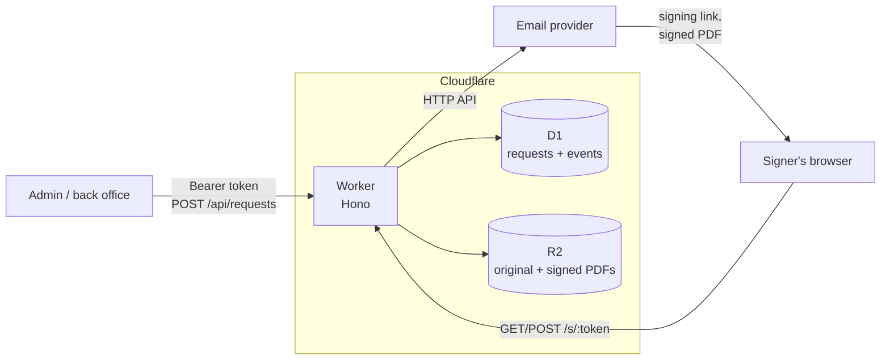
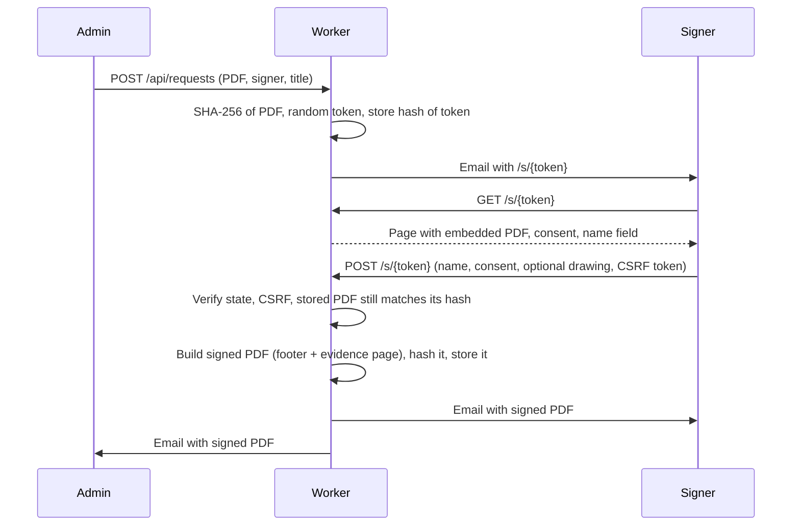

# esign-worker

A small, self-hosted e-signing service for Cloudflare Workers, D1 and R2.

Upload a PDF, send a personal signing link by email, and receive back a signed
PDF with an evidence page and a matching evidence record. One signer per
request, no accounts, no per-envelope fees.

## Why

- **Self-hosted.** Documents and evidence stay in your own Cloudflare account.
- **EU data residency.** D1 and R2 can be created in the EU jurisdiction (see
  [Quick start](#quick-start)).
- **No per-envelope pricing.** You pay for Workers, D1 and R2 usage only.
- **Small enough to audit.** Under 3,000 lines of TypeScript including the page assets, plus tests.

## How it works





A request is `open` until the signer opens the page (`viewed`), then ends as
`signed` or `revoked`. `expired` is derived from `expires_at` at read time, so a
request can never be signed after its deadline, and no cron job is needed.

## Quick start

Requirements: Node.js 20 or later and a Cloudflare account (only for deploying).

```sh
npm install
cp .dev.vars.example .dev.vars        # then put long random values in it
npm run db:migrate:local
npm run dev                          # http://localhost:8787
```

With `EMAIL_PROVIDER=log` (the default) emails are logged with signing links
redacted. Use the `signing_url` returned by the create call instead.

To deploy:

```sh
npx wrangler d1 create esign --jurisdiction eu     # copy database_id into wrangler.jsonc
npx wrangler r2 bucket create esign-documents --jurisdiction eu
npm run db:migrate:remote
npx wrangler secret put ADMIN_TOKEN
npx wrangler secret put APP_SECRET
npx wrangler secret put EMAIL_API_KEY              # if EMAIL_PROVIDER=http
npm run deploy
```

Set `PUBLIC_BASE_URL` to the HTTPS origin the Worker is served on.

### Configuration

| Variable              | Default                         | Purpose                                                 |
| --------------------- | ------------------------------- | ------------------------------------------------------- |
| `ADMIN_TOKEN`         | (secret, required)              | Bearer token for the admin API, at least 32 characters. |
| `APP_SECRET`          | (secret, required)              | Key for CSRF tokens and IP hashing, at least 32 chars.  |
| `EMAIL_API_KEY`       | (secret)                        | Required when `EMAIL_PROVIDER=http`.                    |
| `PUBLIC_BASE_URL`     | (required)                      | Origin used in links and for the CSRF origin check.     |
| `ORG_NAME`            | (required)                      | Shown to signers and on the evidence page.              |
| `MAIL_FROM`           | (required)                      | Sender address.                                         |
| `OWNER_EMAIL`         | unset                           | Receives a copy of every signed PDF.                    |
| `EMAIL_PROVIDER`      | `log`                           | `log` or `http` (Resend-compatible JSON API).           |
| `EMAIL_API_URL`       | `https://api.resend.com/emails` | Endpoint for `http`.                                    |
| `DEFAULT_EXPIRY_DAYS` | `14`                            | Link lifetime when none is given.                       |
| `MAX_EXPIRY_DAYS`     | `60`                            | Upper bound for `expires_in_days`.                      |
| `DOWNLOAD_DAYS`       | `30`                            | How long the signer can download the signed PDF.        |
| `MAX_PDF_BYTES`       | `10485760`                      | Upload limit.                                           |

Configuration is validated on every request; invalid configuration fails
closed with a 500 and logs the names (never the values) of the bad variables.

## API

All admin endpoints require `Authorization: Bearer $ADMIN_TOKEN`. Errors are
JSON: `{"error": "validation_failed", "fields": {...}}` (422), `not_found`
(404), `conflict` (409), `unauthorized` (401).

### Create a signing request

```sh
curl -X POST https://sign.example.com/api/requests \
  -H "Authorization: Bearer $ADMIN_TOKEN" \
  -F file=@agreement.pdf \
  -F title="Service agreement" \
  -F signer_name="Jane Doe" \
  -F signer_email=signer@example.com \
  -F message="Please sign by Friday." \
  -F expires_in_days=7
```

```json
{
  "id": "019a1b2c-...",
  "title": "Service agreement",
  "status": "open",
  "signer": { "name": "Jane Doe", "email": "signer@example.com" },
  "document": { "sha256": "9f2c...", "size": 48213, "pages": 3 },
  "created_at": "2026-03-02T09:00:00.000Z",
  "expires_at": "2026-03-09T09:00:00.000Z",
  "signed": null,
  "signing_url": "https://sign.example.com/s/Xk3...",
  "invitation": "sent"
}
```

`signing_url` is returned only here; the service stores just its hash. If
`invitation` is `failed`, share the link another way or revoke and recreate.
Encrypted or unparsable PDFs are rejected at upload.

### List, inspect, revoke

```sh
curl -H "Authorization: Bearer $ADMIN_TOKEN" \
  "https://sign.example.com/api/requests?status=open&limit=25"
# -> {"data": [...], "next_cursor": "..."}; pass ?cursor=... for the next page.
# status: open | viewed | signed | revoked | expired

curl -H "Authorization: Bearer $ADMIN_TOKEN" https://sign.example.com/api/requests/$ID
# -> request plus its event log (created, invitation_sent, viewed, signed, ...)

curl -X POST -H "Authorization: Bearer $ADMIN_TOKEN" \
  https://sign.example.com/api/requests/$ID/revoke
# 409 if already signed or revoked
```

### Signed PDF and evidence

```sh
curl -H "Authorization: Bearer $ADMIN_TOKEN" -o signed.pdf \
  https://sign.example.com/api/requests/$ID/signed.pdf

curl -H "Authorization: Bearer $ADMIN_TOKEN" \
  https://sign.example.com/api/requests/$ID/evidence.json
```

The evidence record is stored once, at signing time, and returned verbatim:

```json
{
  "version": 1,
  "request_id": "019a1b2c-...",
  "issuer": "Acme B.V.",
  "document": { "title": "Service agreement", "sha256": "9f2c...", "size": 48213, "pages": 3 },
  "signer": {
    "requested_name": "Jane Doe",
    "email": "signer@example.com",
    "typed_name": "Jane Doe"
  },
  "signature": { "method": "typed_name", "drawing_sha256": null },
  "signed_at": "2026-03-02T09:30:00.000Z",
  "ip_hash": "5b1e...",
  "user_agent": "Mozilla/5.0 ...",
  "consent_text": "I have reviewed the document \"Service agreement\" (SHA-256 9f2c...) and agree to sign it electronically with the name I typed.",
  "events": [
    { "type": "created", "at": "..." },
    { "type": "viewed", "at": "..." },
    { "type": "signed", "at": "..." }
  ],
  "signed_document": { "sha256": "c925...", "size": 52107 }
}
```

### Public routes

| Route                    | Purpose                                                                                        |
| ------------------------ | ---------------------------------------------------------------------------------------------- |
| `GET /s/:token`          | Signing page, or the result page once signed.                                                  |
| `POST /s/:token`         | Sign. Form fields: `name`, `consent=yes`, `document_sha256`, `csrf`, optional `signature_svg`. |
| `GET /s/:token/document` | The original PDF, inline, while the request is signable.                                       |
| `GET /s/:token/download` | The signed PDF, for `DOWNLOAD_DAYS` after signing.                                             |

The page works without JavaScript (typed name and consent). With JavaScript, the
signer can also draw a signature, which is submitted as a minimal SVG.

## Security model

- **Links are bearer credentials.** Tokens are 32 random bytes (base64url). Only
  their SHA-256 is stored; lookups are by hash. A database leak does not
  reveal working links.
- **What is signed is what was sent.** The PDF's SHA-256 is fixed when the
  request is created. The document is re-hashed before it is shown and before
  it is signed; on mismatch the signer gets a neutral error and a
  `tamper_detected` event is logged. The form also carries the hash the
  signer was shown.
- **Evidence is immutable.** D1 triggers reject updates to signed or revoked
  requests, changes to fields fixed at creation, backward status transitions,
  deletion of signed requests and any change to the event log. R2 objects are
  written with a SHA-256 checksum and re-verified on download.
- **Exactly one signature.** State changes are conditional updates inside D1
  batches. Concurrent submissions cannot both win, and the loser's uploaded
  PDF is deleted.
- **CSRF.** The signing form carries an HMAC token bound to the request and
  valid for two hours. Cross-site requests are rejected via `Sec-Fetch-Site`
  and `Origin`. (`Origin: null` is accepted because browsers send it on
  same-origin posts from pages with `Referrer-Policy: no-referrer`; the token
  still applies.)
- **Headers.** Strict CSP (`default-src 'none'`, scripts and styles only from
  the Worker, no inline code), `frame-ancestors 'none'` except for the
  embedded PDF, `Referrer-Policy: no-referrer`, `Cache-Control: no-store`,
  HSTS, `nosniff` and `noindex` on every response.
- **Drawn signatures** are parsed with a strict allowlist (`svg`, `g`, `path`,
  a few presentation attributes). Scripts, event handlers, links,
  `foreignObject`, styles, entities and DOCTYPEs are rejected, and only a
  canonical re-serialisation is used.
- **Privacy.** The signer's IP address is stored only as
  `HMAC-SHA256(APP_SECRET, ip)`. This is pseudonymisation, not anonymisation:
  whoever holds `APP_SECRET` can test whether a given IP signed.
- **Admin API.** Bearer token, compared in constant time over SHA-256 digests.
- **Logs.** The Worker never logs tokens (email bodies are redacted in the log
  mailer). Workers invocation logs, which include request URLs, are disabled in
  `wrangler.jsonc`. If you use Logpush or other request logging on the zone,
  make sure `/s/*` paths are excluded or redacted.
- **Rate limiting** is not built in. Tokens are not guessable, but add a
  Cloudflare WAF rate-limiting rule for `/s/*` and `/api/*` to bound abuse and
  cost.

## Legal note

This service produces a **simple electronic signature** in the sense of
eIDAS (Regulation (EU) No 910/2014), article 25(1), backed by an audit trail:
who was invited, when the document was opened and signed, the document's
hash, a pseudonymised IP address and the user agent. It is **not** an advanced
or qualified electronic signature and does not identify the signer beyond
control of their email address.

A simple electronic signature cannot be denied legal effect solely because it
is electronic, but its evidential weight is up to the court. It is suitable for
many everyday agreements; some documents require a qualified signature or a
specific form by law. This is not legal advice; check what applies to your
documents and jurisdiction.

## Limitations and roadmap

- One signer per request; no signing order or multiple parties yet.
- The signed PDF is a rewrite of the original, not an incremental update, so
  existing digital signatures inside an uploaded PDF are invalidated. Uploads
  are not checked for them.
- The evidence page uses the PDF standard fonts: names outside Windows-1252
  are approximated on the page. The evidence JSON keeps the exact text.
- Page footers are not adjusted for rotated pages.
- The signed PDF is not sealed with a certificate (PAdES). Its integrity is
  established through the stored hash. Sealing with an organisation
  certificate is a natural next step.
- Plain-text emails; no resend endpoint (revoke and recreate instead).
- No retention job: records and PDFs are kept until you delete them, and the
  database refuses deletion of signed requests by design. Plan your retention
  policy and, if needed, remove the trigger deliberately in a migration.

## Development

```sh
npm run check     # typecheck, lint, format check, tests
npm test          # Vitest inside the Workers runtime (D1 and R2 emulated)
```

Source layout: `src/domain` (state, service, evidence, sanitiser),
`src/pdf` (stamping), `src/email`, `src/routes`, `src/views`, `migrations`.

## License

MIT, see [LICENSE](LICENSE).

## Nederlands

esign-worker is een kleine, zelf te hosten dienst voor elektronisch
ondertekenen op Cloudflare Workers, D1 en R2, met opslag in de EU. Je uploadt
een pdf, de ondertekenaar krijgt een persoonlijke link per e-mail, en na het
tekenen ontvangen beide partijen een getekende pdf met een bewijspagina
(documenthash, naam, tijdstip, gehashte IP en user agent). Het gaat om een
gewone elektronische handtekening (eIDAS art. 25 lid 1) met audit trail, geen
gekwalificeerde handtekening, en dit is geen juridisch advies.

---

Built by NEXTRIQ (https://nextriq.nl)
